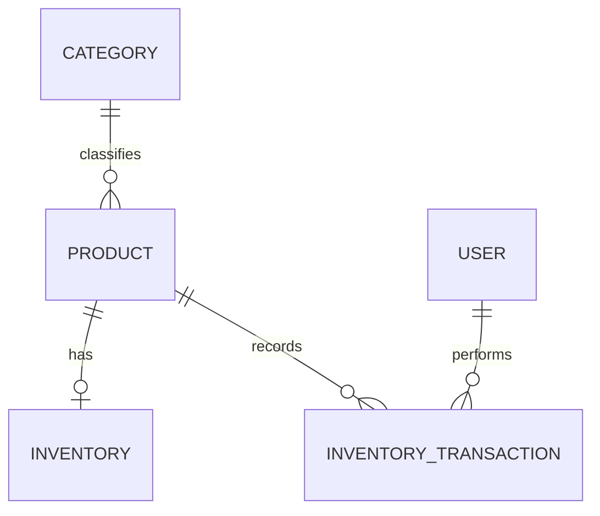

# MongoDB foundation — issue #24

## Scope and SRS mapping

This is the initial Sprint 1 data foundation, adapted from SRS §14 and SAD §8 to the owner's MERN decision. It does not implement login, product CRUD routes, stock-adjustment workflows, purchasing, sales, or reports. Shared models are exported from `server/src/database/models.js`.

| Collection / model | Required business fields | Integrity and indexes |
| --- | --- | --- |
| `users` / User | `name`, `email`, `passwordHash`, `role`, `status` | Unique email; one role from ADMIN/INVENTORY/PURCHASE/SALES/MANAGER; ACTIVE/INACTIVE |
| `categories` / Category | `name` | Unique category name, max 80 characters |
| `products` / Product | `sku`, `name`, `categoryId`, `sellingPriceMinor`, `minimumStock`, `status` | Unique SKU; category reference; nonnegative integer price/threshold; category/status and name indexes |
| `inventory` / Inventory | `productId`, `availableQty` | Unique product reference (one stock record per product); nonnegative integer quantity |
| `inventoryTransactions` / InventoryTransaction | `productId`, `changeQty`, `sourceType`, `sourceId`, `createdBy`, `createdAt` | Signed integer change; PURCHASE/SALE/ADJUSTMENT; product/date, source and actor indexes; adjustment requires a reason |

Every collection has an ObjectId `_id`. Mutable records have `createdAt`/`updatedAt`; history has `createdAt` only. Names, SKU and reasons use the SRS length limits. Integer quantities and prices are bounded by JavaScript's safe integer range. Schemas reject unknown fields.



The optional stock row in the physical diagram reflects creation order; feature services must create a product and its stock row together in a transaction. There must be exactly one row once a product creation workflow completes.

## Explicit physical design decisions

- SRS `role_id` is represented by one validated `role` value on the user document. Role definitions are the five fixed values above; the SRS permission matrix remains the authorization baseline for #7.
- SRS decimal `selling_price` is represented by `sellingPriceMinor`, an integer number of hundredths of the store's currency. For example 1299.00 is stored as 129900. Future APIs must document and consistently use this unit, format amounts for display, and compute totals in exact minor units rather than floating-point decimal arithmetic.
- SKU is normalized to uppercase/trimmed through Mongoose and globally unique, including inactive records. This preserves stable historical identity and implements the SRS §14 unique-SKU field requirement. No SKU recycling is supported.
- Category names are unique and trimmed. Physical collection/field names differ from the logical SQL-style names in the original document.
- An ADJUSTMENT event's `sourceId` equals its own `_id`, with a required `reason`. It is its own source record. A PURCHASE/SALE event will reference the corresponding transaction document; a missing source is rejected.

These are initial shared contracts for review by the feature owners. No authentication endpoint or user-management UI is delivered by this story.

## Where constraints are enforced

1. **MongoDB:** strict collection validators enforce required fields, BSON types, allowed statuses, length/range/integer rules, and adjustment self-reference/reason. Unique indexes enforce identifiers and one inventory row per product. Tests exercise direct database writes to verify constraints independently of Mongoose.
2. **Mongoose/shared services:** `create`/`save` and ordinary update operations check referenced category, product and responsible user records. History also checks its source transaction. Query updates enable Mongoose validation; database validators additionally protect `$inc` stock changes. Reference-bearing models reject `insertMany`, `bulkWrite`, and pipeline updates so feature services use the validated contract.
3. **History/deletion:** history model writes are append-only. Shared deletion hooks reject deleting a referenced category, product, or user. Products/users with history must be deactivated; future supplier records must follow the same policy.

MongoDB has no relational foreign keys. Direct `Model.collection`/driver writes can bypass application reference/deletion checks; feature routes must use reviewed model/service writes. Reference checks alone also do not solve concurrent delete/write races. Prefer deactivation; multi-document business changes must share a session/transaction and enforce authorization, stock availability, and idempotency in the owning feature service. Never expose unrestricted database-write endpoints.

## Reproducible setup

Follow the root README (`npm ci`, copy `.env.example`, `npm run db:start`), then:

```bash
npm run db:setup
```

Setup applies `001-initial-inventory-foundation`, creates collections/validators/indexes, and records the version in `_schemaMigrations`. Repeating it reports Already applied. Before adopting an existing collection, setup rejects documents that violate the proposed schema. It never deletes existing data. Mongoose automatic collection/index creation is disabled; setup is the authoritative initializer.

Migration `002-authentication-sessions` (issue #6) adds the `sessions` collection: `tokenHash` (SHA-256 hex of the cookie token, unique), `userId` (User reference), `expiresAt` and `createdAt`. A TTL index on `expiresAt` lets MongoDB delete expired sessions; the API also rejects expired sessions itself because TTL cleanup can lag by about a minute. Existing databases pick it up with `npm run db:setup`.

Future schema changes must introduce a new reviewed migration/version and data-conversion plan. Do not edit the meaning of an already applied version or delete its record to force reinitialization. No destructive reset command is supplied.

## Development seed data

Choose a development-only password at runtime. In macOS zsh or Linux/macOS Bash, the following keeps it out of shell history and command arguments:

```bash
printf 'Development seed password (12–128 characters): '
read -rs SEED_PASSWORD
printf '\n'
export SEED_PASSWORD
npm run db:seed
unset SEED_PASSWORD
```

In Windows PowerShell:

```powershell
$seedSecret = Read-Host 'Development seed password (12–128 characters)' -AsSecureString
$env:SEED_PASSWORD = [System.Net.NetworkCredential]::new('', $seedSecret).Password
npm run db:seed
Remove-Item Env:\SEED_PASSWORD
Remove-Variable seedSecret
```

Use `npm.cmd` if PowerShell blocks `npm.ps1`. The password is temporarily passed in the process environment for hashing, never stored in a tracked file. Clear it after seeding, including if the command fails.

Six synthetic accounts are defined at `admin`, `inventory`, `purchase`, `sales`, `manager`, and `inactive` **@techzone.example.test**. They cover all five roles plus an inactive account. Passwords use a salted scrypt hash; no default password is committed or printed. User JSON excludes the hash, and normal queries do not select it. Log in to the app with any active seeded account and the seed password. Login and account-status checks are implemented in #6; role permissions follow in #7.

Products cover normal stock, below threshold, exactly at threshold, zero stock, and inactive status. Nonzero opening balances have a traceable adjustment event. Low stock includes equality (BR-003); #19 supplies the actual query/UI.

Seeding uses a transaction, performs setup if needed, and preserves existing records, stock quantities, passwords, and history on repeat runs. It refuses `NODE_ENV=production`. Do not point development seeds at a shared/production database, and do not provide a real account password. If any seeded account already exists, its existing password is preserved, not reset.

## Future supplier/purchase/sale references

Reserve `suppliers`, `purchases`, and `sales` as the future collection names. Suggested document mapping from SRS §§14.3–14.4:

- Supplier: name/contact fields/status; deactivate instead of deleting purchase history.
- Purchase: `supplierId`, order date/status, exact total, and embedded item lines containing `productId`, ordered/received quantities and unit cost. Retain line prices; received quantity must not exceed ordered quantity.
- Sale: unique transaction number, sale date, `createdBy`, exact total, and embedded product/quantity/unit-price lines.
- History: purchase/sale `sourceId` references those root documents, with product and responsible-user links. Source line details and operation/retry IDs may be added in reviewed migrations when receipts/sales are implemented.

These are coordination contracts, not implemented collections or workflows. #15/#16/#17/#18 must add validators/reference guards and atomic receipt/sale/stock/history services; #21/#25/#26 supply integrated tests. Current rollback coverage proves transaction-capable infrastructure, not completed purchasing/sales behavior.

## Verification

`npm test` creates a uniquely named `techzone_test_schema_<random>` database, overrides the database component of `TEST_MONGODB_URI`, and deletes only that generated database at teardown. It does not reset the configured application database. Tests cover replay, seeds/password safety, stock constraints, duplicate keys, references, historical retention, and a forced transaction rollback. See `docs/verification.md` for executed results.
