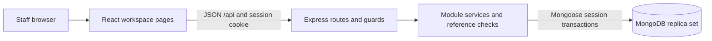

# TechZone — Software Architecture and Design Specification

Team 9 · Revision 2.0 · 11 November 2026 · As implemented

## 1. Purpose, baseline and scope

This is the updated SAD for the delivered system, replacing the original Django/PostgreSQL implementation proposal with the actual MERN design. Requirement IDs remain those of the [revised SRS](software-requirements-specification.md). The original root PDFs remain historical submissions; this revision claims no external sign-off. [Testing evidence](../testing/README.md) records the verified source and limitations.

## 2. Architectural drivers and constraints

Core drivers are server authorization, exact money, nonnegative stock, preservation of history, atomic multi-item purchases/sales and safe request retries. A MongoDB replica set is mandatory for transaction workflows. The system is a small internal application with one React client and one Express API, not a set of independently deployed services. No payment service, message broker, external identity provider or hosted analytics system is present.

The repository uses npm workspaces (`client`, `server`), JavaScript ES modules, Node >=24 and a shared lockfile. Vite/React/Tailwind replace the planned client build; Express replaces Django REST Framework; Mongoose/MongoDB replace PostgreSQL; Node test/Supertest/jsdom replace pytest; GitHub Actions replaces Jenkins. [Decisions](../decisions.md) retain the rationale and original differences.

## 3. Context and component view

| Component / path | Responsibility |
| --- | --- |
| client/src/main.jsx | Login/session lifecycle; seven-page navigation; permission-filtered modules; browser history and active page focus |
| client/src/api.js | Relative JSON requests, errors, filters, Idempotency-Key headers and response adapters |
| LoginForm.jsx / UserList.jsx | Staff login and read-only Team list |
| ProductCatalogue.jsx | Category/product creation/edit and retirement |
| InventoryListing.jsx / StockAdjustments.jsx | Stored stock search/filters/thresholds and signed reasoned adjustments |
| Suppliers.jsx / Purchases.jsx | Contacts, supplier refresh, draft/order editing and safe partial/full receipt retry |
| Sales.jsx / Reports.jsx | Sale cart/history, inventory/low-stock/sales reports |
| server/src/app.js | Express composition, Helmet/CORS/JSON limits, route mounts and generic errors |
| server/src/modules/*/routes.js | Authentication/permission middleware and HTTP/service adaptation |
| server/src/modules/*/service.js | Validation, domain rules, reference checks and transaction ownership |
| server/src/database | Mongoose models, collection validators/indexes, schema migrations and development seed |
| server/src/config | Server-only environment and database connections |
| server/src/index.js | Process startup, connection and listener lifecycle |

## 4. Runtime and authorization view

Login validates bounded credentials, reads the user, checks a salted scrypt hash (or decoy for unknown user), rejects inactive users, ends a supplied previous session and creates a new opaque random token. The client receives only public user fields and permissions. The database stores only a SHA-256 token hash and expiry. Cookies are HttpOnly, SameSite=Strict, `/api`; production adds Secure. Every protected request rechecks the unexpired session and active stored user. Role changes take effect immediately on the next request. Logout deletes the stored session.

| Operation | Allowed roles |
| --- | --- |
| View products, stock, suppliers, purchases and sales | All five roles |
| Create/edit products/categories; adjust stock | ADMIN, INVENTORY |
| Retire products | ADMIN |
| Manage suppliers/orders; receive goods | ADMIN, PURCHASE |
| Create sales | ADMIN, SALES |
| Inventory / low-stock reports | ADMIN, INVENTORY, MANAGER |
| Sales reports | ADMIN, SALES, MANAGER |
| View Team users | ADMIN, MANAGER |

The permission map also defines users:manage and reports:purchases permissions, but no corresponding account mutation or purchase-report routes are implemented. Permission names alone do not establish delivery. See [permissions](../permissions.md) for the complete matrix and regression evidence.

## 5. HTTP interface view

All paths below have `/api` prefix. Only health/readiness and auth login/logout are public; business data and `/auth/me` require a session.

| Routes | Contract |
| --- | --- |
| GET /health; GET /ready | Liveness; actual DB ping, 503 if unavailable |
| POST /auth/login; POST /auth/logout; GET /auth/me | Session creation, termination, current public user |
| GET /users | Read-only permitted user list; no mutation endpoints |
| GET/POST /categories; PATCH/DELETE /categories/:id | Category maintenance; referenced delete rejected |
| GET/POST /products; GET/PATCH/DELETE /products/:id | Product catalogue; logical retirement |
| GET /inventory | Literal name/SKU/category search, category filter, lowStockOnly |
| POST /inventory/:productId/adjustments | Signed changeQty, required reason; actor from session |
| GET/POST /suppliers; GET/PATCH/DELETE /suppliers/:id | Contacts/search/status; logical deactivation |
| GET/POST /purchases; GET/PATCH /purchases/:id | History filters, order creation, unreceived edits and state changes |
| POST /purchases/:id/receipts | Received quantities; Idempotency-Key required |
| GET/POST /sales; GET /sales/:id | Filter history, create/retrieve sale; key required for create |
| GET /reports/inventory; GET /reports/low-stock; GET /reports/sales | Current inventory and sale aggregates with scoped filters |

No general inventory-history endpoint or dedicated purchase-report endpoint exists. Invalid input uses 400, absent reference 404, role denial 403 and domain conflict 409. Unhandled failures return a generic 500 without stack/details. Client code does not receive secrets or raw database failures.

## 6. Data design and integrity view

| Collection | Key contents / constraints |
| --- | --- |
| users | Unique email; role/status; hidden scrypt passwordHash |
| sessions | Unique tokenHash; userId; expiresAt TTL index; runtime expiry check |
| categories | Unique category name |
| products | Unique normalized SKU; categoryId; integer sellingPriceMinor/minimumStock; status |
| inventory | Unique productId; nonnegative safe integer availableQty |
| inventoryTransactions | Product/change/sourceType/sourceId/createdBy/createdAt/reason; indexes by product/date and source; append-only model operations |
| suppliers | Name, optional contact fields, status |
| purchases | Unique orderNumber/requestId; request fingerprint; supplier snapshot; order date/state; exact total; embedded order/received lines |
| purchaseReceipts | Unique requestId; fingerprint; purchase/actor/time; immutable received line history |
| sales | Unique transactionNumber/requestId; date/actor/total; immutable product/price line snapshots |
| _schemaMigrations | Versioned setup records; no destructive replacement of existing application data |

Migrations 001–005 establish foundation, sessions, sales, suppliers and purchases/receipts. `npm run db:setup` applies missing migrations. `npm run db:seed` accepts an externally supplied password, refuses production, generates synthetic development accounts and preserves existing stock/password/history on replay.

MongoDB is not treated as a relational database with native foreign keys. Collection validators and indexes enforce types, bounds and uniqueness. Reference helpers and services check cross-collection existence/active states, serialize risky reference changes and preserve historical snapshots. Direct privileged database writes can bypass application-level reference/immutability contracts; deployment access control remains a prerequisite.

## 7. Transaction and concurrency design

### 7.1 Purchase order and receipt

Creating an order validates active references, snapshots supplier/product fields, derives exact totals and stores the order/request identity without stock movement. Receiving validates state, remaining quantity and active product/stock; increments the intended products; appends audit events with purchase source and session actor; persists receipt and order progress in the same transaction. Partial receipt yields PARTIAL; all lines complete yields RECEIVED. Over-receipt or any later failure aborts the entire operation.

Creation/receipt keys are durable and unique. Stored request fingerprints detect conflicting reuse. A replay returns the existing committed result without reapplying stock. Concurrent receipt keys across different orders cannot commit twice. Client uncertain-response states lock the original body and key for retry. A committed write whose list refresh failed is reported as saved and offers read refresh rather than duplicate submission.

### 7.2 Sale and reusable stock service

The sale service owns the multi-document transaction: validate active products and quantities, derive price snapshots, create sale/source identity, apply guarded per-product decrements and append source/actor history. Insufficient stock on any line aborts all lines. Stable request keys prevent duplicate sale/stock changes on concurrent or later retries.

The reusable stock service composes with a caller transaction or owns one for an independent adjustment. Stock predicates prevent negative values and unsafe overflow. Source/actor checks and reason requirements preserve auditability. Fault injection tests force errors after later-line writes and verify complete raw snapshots. A prior embedded sale-item version-key retry defect was fixed; [stock consistency](../stock-consistency.md) records reproduction and correction. Embedded sale items omit versioning so transaction retry cleanup succeeds.

### 7.3 Reporting

Inventory reports join stored inventory to product/category records and compute thresholds on read. Sales reports sum stored sale snapshots and check aggregate safe-integer limits. Date bounds are inclusive UTC days. Results are current request-time reads; no cross-request report snapshot or cache consistency guarantee is claimed. Purchase history provides per-order totals only; dedicated aggregate purchase reporting is deferred.

## 8. Client state and interaction design

Page navigation keeps module components mounted to preserve drafts and pending retry keys. History/popstate updates the visible page; page headings receive focus and titles reflect the active module. Hidden controls follow permission data; backend guards remain authoritative.

Successful receipts/sales/adjustments increment an inventory refresh key consumed by inventory, stock, sales and reports. Supplier mutations increment a supplier refresh version for order selection without clearing history filters. Money display uses integer minor-unit conversion. Empty-state/status/error messages are explicit. The client is served as a separate Vite application locally; Express does not automatically host the production `client/dist` build.

## 9. Deployment and development view

The portable project MongoDB helper manages a loopback replica set at 27018 with data in ignored `.local/mongodb`; no global service or Atlas account is required. Vite dev proxies `/api` to Express. Environment settings remain server-side and `.env` is ignored. Local no-auth MongoDB must not be exposed publicly. Production needs a client/static host, API routing, TLS, authenticated least-privilege DB access, monitoring and backup design, none verified in this delivery.

GitHub Actions runs lint/build and real database tests on PRs, with native Windows/macOS setup checks as configured. Coverage execution is available through `npm run test:coverage`, using Node built-in events/reporters and LCOV without a new dependency. The reporting scripts preserve source hashes and identify unmeasured frontend/entry-point files.

## 10. Quality, traceability and unresolved design scope

Core validation covers service/API/DOM behavior, role matrices, exact money, rollback, concurrency, retries, end-to-end integration and local performance/volume. Source manifest, raw JSON/LCOV, per-file counts and branch explanations are under [testing](../testing/README.md). Browser checks exercise real Chromium and temporary data; they do not instrument JSX for Node coverage.

Outstanding scope: administrative account mutations, inventory-history filters, dedicated purchase report/aggregate totals, Firefox/Edge execution, production controls and peer review. Coverage excludes unimported server startup and uninstrumented JSX; high backend percentages do not establish complete frontend or baseline requirement coverage. Updated [Test Plan](software-test-plan.md) ties each original TC to implementation, change, procedure and result.
